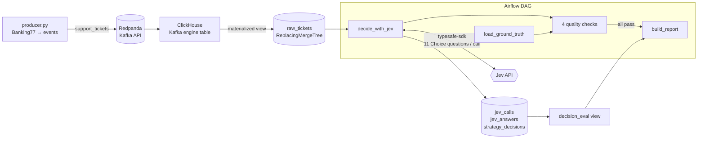

# Jev decision pipeline

**Can you trust Jev's confidence enough to let it route support tickets on its own?**

This project streams 3,080 real banking support messages through Kafka into
ClickHouse, asks [TypeSafe's Jev](https://typesafe.ai) to classify each one into
77 intents, and measures whether Jev's probabilities are *calibrated*: when it
says 90%, is it right about 90% of the time? That matters because calibrated
confidence is what lets software decide when to act alone and when to ask a person.

> **Finding:** Jev's flat 77-way Choice was 81.6% accurate and could
> auto-handle **64.5% of tickets at 95% accuracy** (confidence ≥ 0.96). It is
> overconfident: above 0.8 its stated probabilities averaged 97.7% while it was
> right 89.9% of the time, about 8 points high (ECE 0.096). So use a measured
> threshold, not the raw number. Fanning out into area-then-intent questions
> *hurt*: 71.5% accuracy, ECE 0.155, and it never reached 95% accuracy at any
> threshold.
>
> All 3,080 tickets were decided by `jev-1.13.0` with no failed calls, at
> 157 ms median latency, for $0.60.
>
> 📊 [Calibration report](reports/calibration_report.html) ·
> 🧾 [Raw API responses](evidence/jev_responses_sample.jsonl)

## What's measured

Two ways of asking Jev the same thing, in **one API call per ticket**:

| Strategy | How |
|---|---|
| **Flat** | One Choice question with all 77 intents |
| **Fan-out** | A 9-way "which area?" Choice plus one within-area Choice per area, all asked speculatively in the same request. Code combines them: `P(intent) = P(area) × P(intent \| area)` |

TypeSafe's docs recommend decomposing broad questions into narrow ones and
composing them in code. This tests whether that holds for a 77-class problem.

For each strategy the report shows accuracy, expected calibration error (ECE),
a reliability diagram, the share of tickets that can be auto-handled at 90/95/98%
accuracy (and the threshold that gets you there), and the most common confusions.

## Results

Run on 2026-10-16: all 3,080 Banking77 test tickets, one call each, every call
served by `jev-1.13.0`.

### Accuracy and calibration

| | Flat | Fan-out |
|---|---|---|
| Accuracy | **81.6%** | 71.5% |
| Mean stated confidence | 91.2% | 86.8% |
| Expected calibration error (ECE) | **0.096** | 0.155 |
| Brier score (top choice) | **0.121** | 0.184 |

Both strategies claim more than they deliver. Flat is about 10 points
overconfident overall, fan-out about 15.

### How much can run on its own

The share of tickets you can auto-handle while keeping accuracy at the target,
and the confidence cutoff that gets you there:

| Target accuracy | Flat | Fan-out |
|---|---|---|
| 90% | 81.6% of tickets (cutoff 0.80) | 55.0% (cutoff 0.96) |
| 95% | **64.5%** (cutoff 0.96) | not reachable |
| 98% | 0.3% (cutoff 1.00) | not reachable |

### Where the confidence goes wrong (flat)

| Stated confidence | Tickets | Actually right |
|---|---|---|
| 0.5–0.6 | 137 | 35% |
| 0.6–0.7 | 195 | 51% |
| 0.7–0.8 | 156 | 54% |
| 0.8–0.9 | 235 | 61% |
| 0.9–1.0 | 2,282 | 93% |

Most answers (74%) land in the top band, where Jev says about 99% and is right
93% of the time. Below 0.9 the gap is much wider, about 15–25 points. So the
raw number isn't safe to use as a probability, but it does rank answers well:
higher confidence really is more accurate, which is why a measured cutoff works.

### Most common mistakes

| Actual intent | Predicted as | Times | Strategy |
|---|---|---|---|
| `card_acceptance` | `declined_card_payment` | 38 | fan-out |
| `card_payment_wrong_exchange_rate` | `exchange_rate` | 34 | fan-out |
| `card_swallowed` | `atm_support` | 30 | fan-out |
| `get_physical_card` | `change_pin` | 29 | flat |
| `card_delivery_estimate` | `card_arrival` | 29 / 26 | flat / fan-out |

These are near-duplicate intents, and they're the first place to improve the
wording in [`questions.py`](jevpipe/questions.py).

### What this means

1. **Ask the flat question.** On this task, TypeSafe's advice to break a broad
   question into narrow ones made things worse. The fan-out multiplies the area
   answer by the within-area answer, so mistakes at either step add up. It lost
   10 points of accuracy and was never accurate enough for a 95% target.
2. **Use a measured cutoff, not the raw confidence.** Routing tickets where flat
   confidence is ≥ 0.96 automatically and sending the rest to a person gives
   95% accuracy on 64.5% of the volume.
3. **It's cheap and fast.** 3,080 calls with 11 questions each cost $0.60
   (14.3M input tokens, about 4,600 per call). Median latency was 157 ms
   (p95 264 ms, p99 330 ms), with no failed calls and no retries.

### Things the run turned up

- **Jev rounds each probability to 2 decimals**, so an 11-way answer can sum to
  0.99 or 1.01. The probabilities-sum check originally used a 0.01 tolerance and
  failed on 2 such answers. It now allows 0.02.
- **Jev's `confidence` field is not the top probability.** It is rescaled for the
  number of options (see `choice_confidence` in
  [`strategies.py`](jevpipe/strategies.py)), e.g. a top probability of 0.56 came
  back as confidence 0.52. The report calibrates the top probability, not this field.
- **A capped run used to fail on purpose.** `make smoke` decides only 25
  tickets, so the "every ticket decided" check always failed it. That check now
  only warns when `limit` is set; full runs are still strict.

## Architecture



| Choice | Why |
|---|---|
| ClickHouse pulls from Kafka itself (Kafka engine + MV) | No consumer service to run; ingestion is declarative SQL |
| `ReplacingMergeTree` keyed on `event_id`, reads use `FINAL` | Kafka delivers at least once; replays and duplicates collapse instead of double-counting |
| Labels load from a separate source, never through the stream | Mirrors production, where outcomes arrive after the decision |
| Every answer stores `question_version` (hash of `questions.py`) | Change a question and old/new results never mix; reruns only decide what's missing |
| One `jev_calls` row per request (latency, tokens, retries) | Cost and reliability are queryable, and reconcile with TypeSafe's usage page |
| All questions and thresholds live in [`jevpipe/questions.py`](jevpipe/questions.py) | TypeSafe's own advice: keep them reviewable in one place |
| Calibration math runs in ClickHouse (window functions) | The warehouse does the aggregation; Python only draws |
| Airflow quality checks gate the report | A bad batch fails the run instead of publishing wrong numbers |
| `decide_with_jev` has no task retry; `max_active_runs=1` | Reruns are already resumable (only pending tickets are decided), so a retry would only re-bill calls; one run at a time avoids double-deciding |

## How you know this is real Jev output

Nothing in the report is hand-entered. Each decision stores what only
TypeSafe's servers return:

- **`model_served`**: the model version from each API response (e.g. `jev-1.13.0`)
- **`request_id`**: the `x-typesafe-request-id` header, captured by a thin
  transport wrapper around the official SDK
- **Token usage per call**, so totals can be checked against the TypeSafe console

The report only shows **Verified Jev run** when every row came from the API.
The mock server used for testing serves `MOCK-not-jev` and stamps its reports
*Synthetic data — not Jev results*; mock and real rows are kept apart by an
`is_mock` column. A sample of untouched responses is committed in
[`evidence/`](evidence/).

## Run it

Requires Docker, Python 3.11+, and a TypeSafe API key from the
[console](https://console.typesafe.ai/keys).

```bash
python -m venv .venv && source .venv/bin/activate
cp .env.example .env          # add TYPESAFE_API_KEY
make setup up schema          # deps + Airflow metadata DB, Kafka + ClickHouse, tables
make produce                  # stream 3,080 tickets into Kafka
make smoke                    # DAG run capped at 25 real Jev calls
make decide                   # full DAG run: decide the rest, check, build reports/calibration_report.html
make ui                       # optional: Airflow UI at localhost:8080
```

No key yet? `JEV_MOCK=1 make decide` runs everything against the mock server.
`make test` runs the unit tests (no services needed).

`make smoke` decides the *next* 25 pending tickets each time it runs, and
`make decide` then picks up whatever is left, so no call is ever repeated.

### Setup gotchas

- **Apple Silicon:** make sure the virtualenv's Python is a native arm64 build
  (`python -c "import platform; print(platform.machine())"` should print
  `arm64`). An Intel Python (e.g. from an Intel Anaconda install, which runs
  under Rosetta) can't find a prebuilt `libcst` wheel, which Airflow needs, and
  fails with `can't find Rust compiler`. With `uv`:
  `uv venv --python cpython-3.12-macos-aarch64-none .venv`.
- **Docker must be running** before `make up`, or it fails with
  `Cannot connect to the Docker daemon`. On macOS: `open -a Docker`.
- `make down` keeps ClickHouse's data in a Docker volume, so results survive
  a restart. Kafka's copy of the stream does not, but every ticket is already in
  ClickHouse.

### Quality checks

The DAG ([`dags/jev_pipeline.py`](dags/jev_pipeline.py)) runs four quality checks
after deciding: probabilities sum to 1 (within 0.02, since Jev rounds), no ticket left undecided, every decision has
a label (these three fail the run), and every call carries a request ID (warns only).
On a capped run like `make smoke`, undecided tickets are expected, so that check
only warns. `build_report` runs only if they pass. The DAG is scheduled every 10 minutes to
pick up newly streamed tickets, and is paused until you turn it on.

## If I were building TypeSafe's data platform

This repo is a small version of a problem TypeSafe has right now: every Jev call
is an event worth keeping. Where I'd take it:

1. **One usage-event schema at the API edge.** Org, key, model version, question
   types and counts, tokens, latency, status, request ID. Emitted to Kafka, landed
   in ClickHouse the same way `raw_tickets` is here.
2. **Billing and analytics from the same table.** ClickHouse materialized views
   rolling events into per-org hourly usage. One source of truth, so billing and
   dashboards can't disagree.
3. **Permissions in the warehouse, not the BI tool.** ClickHouse row policies
   scoped by org for anything customer-facing; role-based grants for internal teams.
4. **A model-quality loop.** Customers' downstream outcomes (where shared), joined
   back to decisions like `decision_eval` does here, give calibration per model
   version in production, not just on benchmarks.
5. **Contracts on the event stream.** Schema registry plus checks like the ones
   here (probabilities sum to 1, no gaps) so a bad deploy shows up as a failed
   check, not a wrong invoice.

## Limits

- Banking77 is short, single-intent English messages; real tickets are messier.
- The 77 intent descriptions in `questions.py` are mine. Better wording would
  likely move accuracy; that's a lever, not a fixed property of Jev.
- Calibration describes groups of predictions, not any single answer.
- These results are from one run, on one dataset, with one model version
  (`jev-1.13.0`). A new model version would need its own run.

Dataset: [Banking77](https://github.com/PolyAI-LDN/task-specific-datasets)
(PolyAI, CC-BY-4.0).
