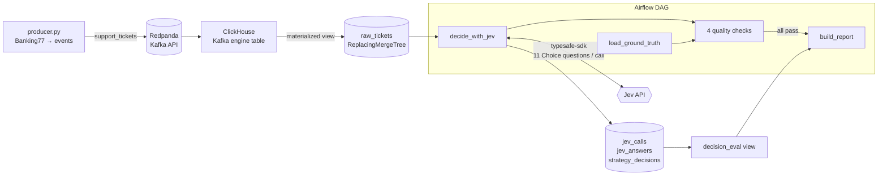

# Jev decision pipeline

**Can you trust Jev's confidence enough to let it route support tickets on its own?**

This project streams 3,080 real banking support messages through Kafka into
ClickHouse, asks [TypeSafe's Jev](https://typesafe.ai) to classify each one into
77 intents, and measures whether Jev's probabilities are *calibrated*: when it
says 90%, is it right about 90% of the time? That matters because calibrated
confidence is what lets software decide when to act alone and when to ask a person.

> **Finding:** _fill in after the real run, e.g. "Jev's flat 77-way Choice
> auto-handled X% of tickets at 95% accuracy; its stated probabilities ran
> Y points under/over actual accuracy above 0.8."_
>
> 📊 [Calibration report](reports/calibration_report.html) ·
> 🧾 [Raw API responses](evidence/jev_responses_sample.jsonl)

## What's measured

Two ways of asking Jev the same thing, in **one API call per ticket**:

| Strategy | How |
|---|---|
| **Flat** | One Choice question with all 77 intents |
| **Fan-out** | A 9-way "which area?" Choice plus one within-area Choice per area, all asked speculatively in the same request. Code combines them: `P(intent) = P(area) × P(intent \| area)` |

TypeSafe's docs recommend decomposing broad questions into narrow ones and
composing them in code. This tests whether that holds for a 77-class problem.

For each strategy the report shows accuracy, expected calibration error (ECE),
a reliability diagram, the share of tickets that can be auto-handled at 90/95/98%
accuracy (and the threshold that gets you there), and the most common confusions.

## Architecture



| Choice | Why |
|---|---|
| ClickHouse pulls from Kafka itself (Kafka engine + MV) | No consumer service to run; ingestion is declarative SQL |
| `ReplacingMergeTree` keyed on `event_id`, reads use `FINAL` | Kafka delivers at least once; replays and duplicates collapse instead of double-counting |
| Labels load from a separate source, never through the stream | Mirrors production, where outcomes arrive after the decision |
| Every answer stores `question_version` (hash of `questions.py`) | Change a question and old/new results never mix; reruns only decide what's missing |
| One `jev_calls` row per request (latency, tokens, retries) | Cost and reliability are queryable, and reconcile with TypeSafe's usage page |
| All questions and thresholds live in [`jevpipe/questions.py`](jevpipe/questions.py) | TypeSafe's own advice: keep them reviewable in one place |
| Calibration math runs in ClickHouse (window functions) | The warehouse does the aggregation; Python only draws |
| Airflow quality checks gate the report | A bad batch fails the run instead of publishing wrong numbers |
| `decide_with_jev` has no task retry; `max_active_runs=1` | Reruns are already resumable (only pending tickets are decided), so a retry would only re-bill calls; one run at a time avoids double-deciding |

## How you know this is real Jev output

Nothing in the report is hand-entered. Each decision stores what only
TypeSafe's servers return:

- **`model_served`**: the model version from each API response (e.g. `jev-1.13.0`)
- **`request_id`**: the `x-typesafe-request-id` header, captured by a thin
  transport wrapper around the official SDK
- **Token usage per call**, so totals can be checked against the TypeSafe console

The report only shows **Verified Jev run** when every row came from the API.
The mock server used for testing serves `MOCK-not-jev` and stamps its reports
*Synthetic data — not Jev results*; mock and real rows are kept apart by an
`is_mock` column. A sample of untouched responses is committed in
[`evidence/`](evidence/).

## Run it

Requires Docker, Python 3.11+, and a TypeSafe API key from the
[console](https://console.typesafe.ai/keys).

```bash
python -m venv .venv && source .venv/bin/activate
cp .env.example .env          # add TYPESAFE_API_KEY
make setup up schema          # deps + Airflow metadata DB, Kafka + ClickHouse, tables
make produce                  # stream 3,080 tickets into Kafka
make smoke                    # DAG run capped at 25 real Jev calls
make decide                   # full DAG run: decide the rest, check, build reports/calibration_report.html
make ui                       # optional: Airflow UI at localhost:8080
```

No key yet? `JEV_MOCK=1 make decide` runs everything against the mock server.
`make test` runs the unit tests (no services needed).

The DAG ([`dags/jev_pipeline.py`](dags/jev_pipeline.py)) runs four quality checks
after deciding: probabilities sum to 1, no ticket left undecided, every decision has
a label (these three fail the run), and every call carries a request ID (warns only).
On a capped run like `make smoke`, undecided tickets are expected, so that check
only warns. `build_report` runs only if they pass. The DAG is scheduled every 10 minutes to
pick up newly streamed tickets, and is paused until you turn it on.

## If I were building TypeSafe's data platform

This repo is a small version of a problem TypeSafe has right now: every Jev call
is an event worth keeping. Where I'd take it:

1. **One usage-event schema at the API edge.** Org, key, model version, question
   types and counts, tokens, latency, status, request ID. Emitted to Kafka, landed
   in ClickHouse the same way `raw_tickets` is here.
2. **Billing and analytics from the same table.** ClickHouse materialized views
   rolling events into per-org hourly usage. One source of truth, so billing and
   dashboards can't disagree.
3. **Permissions in the warehouse, not the BI tool.** ClickHouse row policies
   scoped by org for anything customer-facing; role-based grants for internal teams.
4. **A model-quality loop.** Customers' downstream outcomes (where shared), joined
   back to decisions like `decision_eval` does here, give calibration per model
   version in production, not just on benchmarks.
5. **Contracts on the event stream.** Schema registry plus checks like the ones
   here (probabilities sum to 1, no gaps) so a bad deploy shows up as a failed
   check, not a wrong invoice.

## Limits

- Banking77 is short, single-intent English messages; real tickets are messier.
- The 77 intent descriptions in `questions.py` are mine. Better wording would
  likely move accuracy; that's a lever, not a fixed property of Jev.
- Calibration describes groups of predictions, not any single answer.

Dataset: [Banking77](https://github.com/PolyAI-LDN/task-specific-datasets)
(PolyAI, CC-BY-4.0).
